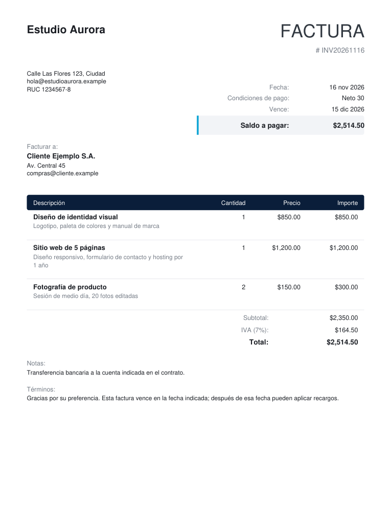

<p align="center"></p>

# Generador de facturas

Un generador de facturas, proformas y cotizaciones en **PDF**, sencillo y gratis, para emprendedores y pequeños negocios.
Sin cuentas, sin suscripción y **sin guardar tus datos**: el PDF se arma en tu navegador.



## Qué hace
- Factura, pro forma o cotización, en **español o inglés**.
- Tu logo (opcional), datos del negocio y del cliente, fecha, vencimiento, condiciones de pago y orden de compra.
- Artículos con descripción de varias líneas, cantidad y precio; **descuento** (% o monto), **impuesto** (IVA, ITBMS, IGV… el nombre y el % los pones tú), envío y pagado (calcula el saldo).
- Varias páginas con encabezado repetido y numeración de páginas.
- **Historial de facturas** en tu navegador: vuelve a abrir, **edita** (monto, cantidad, lo que sea), duplica con número nuevo o borra. No se guarda en el servidor.
- Número de factura automático (`INV20261116`, `INV20261116-2`…) que no se repite.
- Funciona bien en el celular.

## Privacidad
- El PDF se genera **en tu navegador** (con [jsPDF](https://github.com/parallax/jsPDF)). El servidor **no recibe** clientes, artículos ni montos.
- El servidor solo guarda los **números de factura ya usados** (`datos/numeros.txt`) para no repetirlos. No hay historial.
- Los datos de tu negocio, tu logo, tus términos y el **historial de facturas** se guardan solo en tu propio navegador (`localStorage`). Cada aparato tiene su propio historial; si borras los datos del navegador, se pierde.

## Usar
Necesitas Python 3.8 o más nuevo (no hay nada que instalar).

```bash
git clone https://github.com/KleverBatista-max/generador-facturas
cd generador-facturas
python3 server.py
# abre http://127.0.0.1:8080
```

Opciones (variables de entorno, todas opcionales):

| Variable | Para qué | Por defecto |
|---|---|---|
| `PORT` | puerto | `8080` |
| `HOST` | dirección donde escucha (`0.0.0.0` = toda la red) | `127.0.0.1` |
| `CLAVE` | contraseña de acceso | sin contraseña |
| `PREFIJO` | prefijo del número de factura | `INV` |
| `DATA` | carpeta de `numeros.txt` | `./datos` |

**Si lo pones en internet, define `CLAVE`** y ponlo detrás de HTTPS (Caddy, nginx, Tailscale Funnel, Cloudflare Tunnel…).
Sin `CLAVE` cualquiera con acceso a la página puede usarla; está pensado para tu computadora o una red privada.

```bash
CLAVE='mi-clave-larga' PREFIJO=FAC HOST=127.0.0.1 PORT=8096 python3 server.py
```

Para dejarlo siempre encendido en un servidor Linux, un servicio de systemd basta:

```ini
[Service]
User=facturas
WorkingDirectory=/home/facturas/app
Environment=CLAVE=mi-clave-larga PORT=8096 DATA=/home/facturas/datos
ExecStart=/usr/bin/python3 /home/facturas/app/server.py
Restart=always
```

## Personalizar
- Textos y valores por defecto (nombre, datos, términos, idioma, impuesto): objeto `DEF` al inicio del `<script>` de `index.html`.
- Colores del PDF: constantes `NAVY` y `CY` dentro de `armaPdf()`.
- Moneda: escribe tu símbolo en el campo «Símbolo de moneda» (`$`, `€`, `S/`, `Q`…). Los símbolos que no existan en la fuente estándar del PDF (p. ej. `₡`) no se dibujan: usa letras (`CRC`).

## English
A simple, free **invoice / pro forma / quote PDF generator** for small businesses. The PDF is built **in the browser**; the server only stores the invoice numbers already used (no clients, items or amounts). Run `python3 server.py`, open `http://127.0.0.1:8080`. Set `CLAVE` (password) if you expose it to the internet. Spanish and English PDFs, optional logo, discount/tax/shipping, multi-page.

## Licencia
MIT. Incluye [jsPDF](https://github.com/parallax/jsPDF) 2.5.1 (MIT) en `vendor/`.
